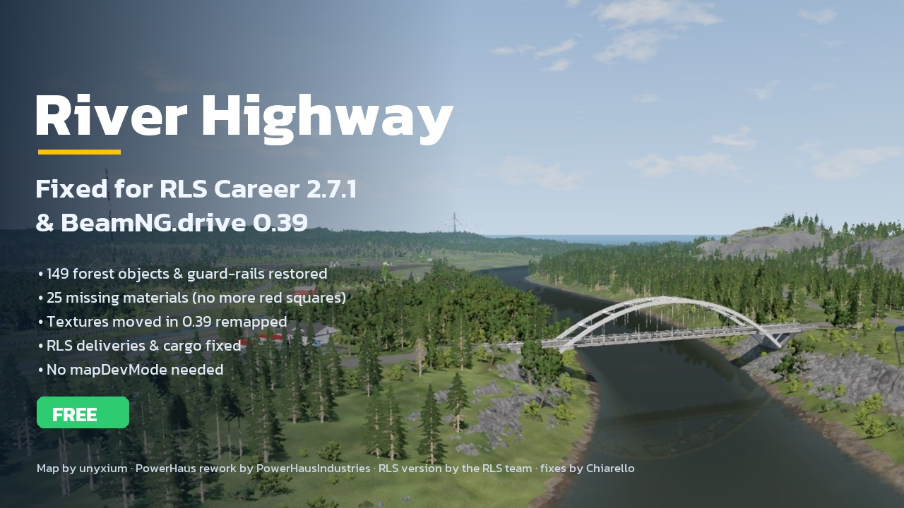

# River Highway for RLS Career — fixed for BeamNG.drive 0.39

The RLS career version of **River Highway**, fixed to run properly on **BeamNG.drive 0.39** with
**RLS Career Overhaul 2.7.1**. One zip: drop it in your mods folder and start an RLS career on River Highway.

**Download:** [Releases](https://github.com/ChiarelloB/RiverHighway-RLS-Fixed/releases/latest) — `rls_river_highway_fixed_v0.1.1.zip`

## Credits

- **River Highway** — original map by **unyxium**
- **River Highway PowerHaus Rework** — **PowerHausIndustries**
- **RLS career version** (`rls_river_highway_public_0.1`) — the **RLS team** (Raceless)
- **0.39 / RLS 2.7.1 fixes** — Chiarello (River Pack)

Redistributed with the authors' permission. All map content belongs to its authors.

## What was fixed

- Trees, rocks, poles and guard-rails borrowed from West Coast USA had lost their definitions in 0.39
  (about 111 thousand objects were missing and the guard-rails had no collision): 149 forest definitions restored.
- 25 materials that only existed in the West Coast folder (the red "no material" squares all over the map).
- Textures that moved in BeamNG 0.39 (plywood, fir bark and leaves, groundcover...) remapped.
- RLS deliveries: restaurant supplies nobody provided, sawmills refusing the 40 ft tilt-deck, container frames
  with nowhere to go, and the "Could not generate items after 10 tries" freeze.
- Groundcover grass uses the game's own GridMap shape.
- Everything is inside the zip: RLS `mapDevMode` is no longer needed.

## Requirements

- BeamNG.drive 0.39.x
- RLS Career Overhaul 2.7.1 (hotfix), installed by you — **not included**

## Install

1. Remove the original `rls_river_highway_public_0.1.zip` from your mods folder if you have it.
2. Copy `rls_river_highway_fixed_v0.1.1.zip` (do not unzip) to `%LocalAppData%\BeamNG\BeamNG.drive\current\mods`.
3. Start a new RLS career and choose River Highway.

Works great with [RiverLife](https://github.com/ChiarelloB/RiverLife-BeamNG) (free player economy for RLS:
classifieds, dealerships, workshops, BeamMP).

Not affiliated with BeamNG GmbH. Some warnings about missing objects may still appear in the log; they come from
the map itself and do not affect the game.
